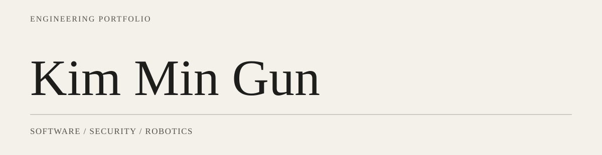
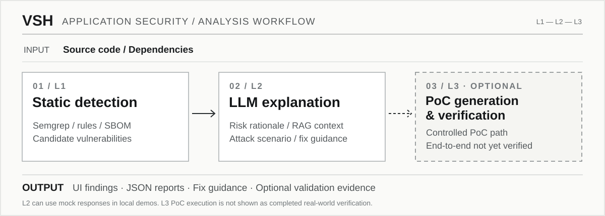
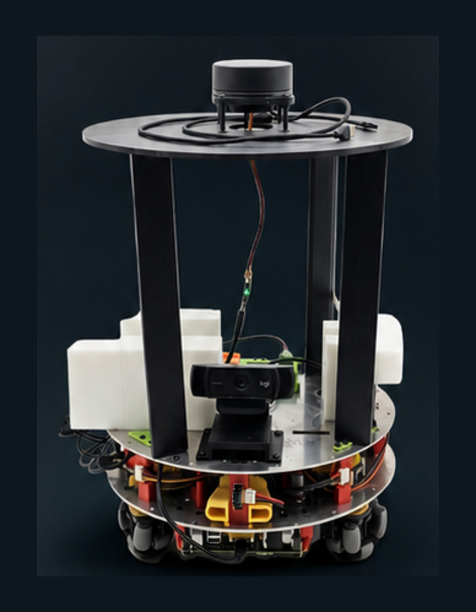

<picture>
  <source media="(max-width: 600px)" srcset="assets/profile-banner-mobile.svg">
  
</picture>

<a href="README.md">한국어</a> &nbsp; | &nbsp; <strong>English</strong>

# Kim Min Gun

**Software Engineering · Security · Systems · Robotics**

I build security analysis tools and integrate real-world robotics systems with ROS 2. My portfolio emphasizes **what I implemented, what I tested, and what remains unverified**, rather than feature claims alone.

Software Engineering undergraduate · Expected graduation: February 2027

[Technical blog](https://rasasoe.tistory.com/) · [Completed projects](#completed-projects) · [In progress](#in-progress)

---

## Completed Projects

These projects have documented implementation and demonstration or local test results. *Completed* refers to the described and verified scope, not production certification of every feature.

### 01. [VSH — Application Security Analysis](https://github.com/rasasoe/VSH)

**AppSec prototype connecting static-analysis findings to a UI and shared report format**

- **My contribution:** Built on an [upstream team-project fork](https://github.com/vmfmgl0607/VSH); individually extended Semgrep execution and configuration, Windows tool wrappers, Finding v1.0 JSON export, and tests.
- **Verification:** 81 unit tests passed, the same 81 passed in reversed order, and the React production build passed (September 16, 2026).
- **Limitations:** L2 mock reasoning and optional L3 checks are distinguished from verified findings. Tests do not establish exploitability or real LLM analysis quality.

`Python` · `FastAPI` · `Semgrep` · `React` · `Electron`

[Demo screenshot](https://github.com/rasasoe/VSH#실행-화면) · [Contributions and commits](https://github.com/rasasoe/VSH#my-contributions) · [Verification notes](https://github.com/rasasoe/VSH#검증과-한계)

### 02. [BuddyBot — ROS 2 Indoor Mobile Robot](https://github.com/rasasoe/BuddyBot)

**Three-person capstone · Team lead / system architecture / integration**

- Split ROS 2 perception and navigation on Raspberry Pi 5 from Raspberry Pi Pico motor control, connected over UART.
- Integrated LiDAR navigation, person following, voice requests, command arbitration, and watchdog-based safety control.
- Published **real robot navigation, following, and voice-command demos** in the repository.

`ROS 2` · `Python` · `Raspberry Pi` · `RP2040` · `OpenCV`

[Working demos](https://github.com/rasasoe/BuddyBot#동작-데모) · [System architecture](https://github.com/rasasoe/BuddyBot#전체-아키텍처)

### Other Implemented and Tested Projects

| Project | Implemented and verified scope |
| --- | --- |
| [DotasPlus](https://github.com/rasasoe/DotasPlus) | Document → IOC extraction → asset matching → incident workflow; 9 local fixture tests passed |
| [Python ASM Framework](https://github.com/rasasoe/python-asm-framework) | Authorized target checks, attack-surface normalization, and Finding exports; 6 offline unit tests passed |
| [AMR](https://github.com/rasasoe/AMR) · [MRP3MV4](https://github.com/rasasoe/MRP3MV4) | Encoder feedback/P-control and AVR holonomic robot experiments; separate predecessors to BuddyBot |

DotasPlus and ASM test results use local fixtures or simulated inputs, not independently verified external end-to-end collection.

---

## In Progress

### [AEGIS — Autonomous Security AI Platform](https://github.com/rasasoe/AEGIS-Showcase)

**A personal security AI project separating local model reasoning from tool-execution authority**

Integrating PentAGI and Ollama with scope validation, explicit approval, isolated execution, and evidence review.

- **Implemented and locally verified:** Python Controller, model connection, approval/scope checks, simulated lifecycle-monitor tests; 305/305 regression tests passed (October 26, 2026).
- **In progress:** Verifying native PentAGI Flow termination and acquiring real end-to-end autonomous security analysis evidence.
- **Publication:** Design and verification reports are public; development source code remains private.

`Python` · `Ollama` · `PentAGI` · `Docker` · `QEMU`

[Architecture and development status](https://github.com/rasasoe/AEGIS-Showcase)

---

### Technical Areas and Notes

**Python · Linux · Docker · FastAPI · AppSec · ROS 2 · Embedded systems**

Engineering notes and technical learning: [Devin's Security Lab](https://rasasoe.tistory.com/).
