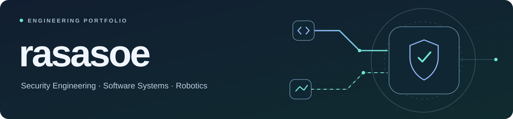
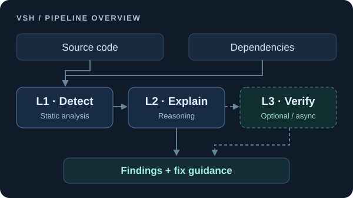
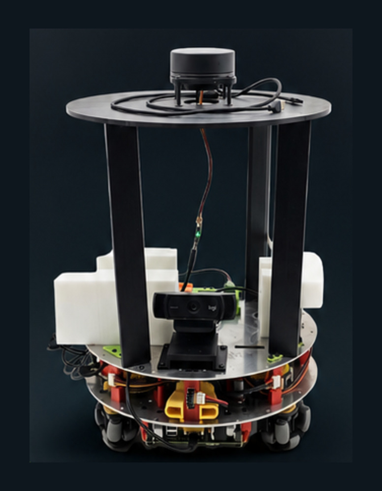

<picture>
  <source media="(max-width: 600px)" srcset="assets/profile-banner-mobile.svg">
  
</picture>

🌐 <a href="README.md">🇰🇷 한국어</a> &nbsp; | &nbsp; <strong>🇺🇸 English</strong>

# Min Gun Kim

**Security Engineering · Software Systems · Robotics**

Software engineering student building security analysis systems and validating system-level design through real-world robotics integration.

**My focus is to explain why a finding matters, retain evidence, and turn architectural decisions into working systems.**

[Technical blog](https://rasasoe.tistory.com/) · [Featured projects](#featured-projects) · [Security projects](#security-projects) · [Robotics journey](#robotics-journey)

## Featured Projects

### [AEGIS — Autonomous Security AI Platform](https://github.com/rasasoe/AEGIS-Showcase) · In Development

A local-first security AI engineering project integrating **Ollama and PentAGI** with separate approval, scope validation, isolated execution and evidence-oriented analysis.

- **Verified development checkpoint:** local model response, API integration, **305/305** automated regression tests (October 26, 2026)
- **Still under verification:** native PentAGI Flow cancellation, lifecycle monitor deployment and real autonomous vulnerability analysis
- **Publication:** public documentation, private development code

`Python` · `Ollama` · `PentAGI` · `Docker` · `QEMU` · `SQLite` · [Project architecture and roadmap](https://github.com/rasasoe/AEGIS-Showcase)

<table>
<tr>
  <td width="50%" valign="top">
    <h3><a href="https://github.com/rasasoe/VSH">VSH ↗</a></h3>
    
<strong>Application Security Prototype</strong>

    

    
Source and dependency security findings with an analysis UI. Documented extensions to an existing upstream fork, including Semgrep integration and Finding v1.0 exports.

    
<code>Python</code> <code>FastAPI</code> <code>Electron</code>

    
<a href="https://github.com/rasasoe/VSH">Repository</a> · <a href="https://github.com/rasasoe/VSH/blob/main/README.en.md">English overview</a>

  </td>
  <td width="50%" valign="top">
    <h3><a href="https://github.com/rasasoe/BuddyBot">BuddyBot ↗</a></h3>
    
<strong>ROS 2 Autonomous Indoor Robot</strong>

    

    
ROS 2 robot with separated Raspberry Pi 5 perception/navigation and Pico motor/safety control; physical movement and interaction demos.

    
<code>ROS 2</code> <code>RP2040</code> <code>OpenCV</code>

    
<a href="https://github.com/rasasoe/BuddyBot">Repository</a> · <a href="https://github.com/rasasoe/BuddyBot/blob/main/README.en.md">English overview</a>

  </td>
</tr>
</table>

**BuddyBot responsibility:** team lead, overall system architecture, and integration within a three-person team.

## Security Projects

- **[AEGIS](https://github.com/rasasoe/AEGIS-Showcase)** — local-first autonomous security AI platform (in development; native execution verification pending).
- **[VSH](https://github.com/rasasoe/VSH)** — application security analysis and finding explanations; original upstream fork with independently documented enhancements.
- **[Python ASM Framework](https://github.com/rasasoe/python-asm-framework)** — authorized asset and attack-surface observations, including service and API exposure.
- **[DotasPlus](https://github.com/rasasoe/DotasPlus)** — defensive threat intelligence pipeline: documents, indicators, protected assets and incidents.
- **[DOTAS v1.3](https://github.com/rasasoe/DarkWeb_Alarm)** — earlier lightweight OSINT/indicator alert prototype.

VSH, ASM, and DotasPlus have a **Finding v1.0 JSON export contract**. A unified operational dashboard is planned, not yet demonstrated.

## Robotics Journey

**[MRP3MV4](https://github.com/rasasoe/MRP3MV4) → [AMR](https://github.com/rasasoe/AMR) → [BuddyBot](https://github.com/rasasoe/BuddyBot)**

From AVR/LM629 holonomic-drive demonstrations to Pico-based encoder feedback and inverse kinematics, then ROS 2 system integration. These are separate codebases connected by engineering concepts, rather than a single source-code lineage.

The optional [BuddyBot-ai](https://github.com/rasasoe/BuddyBot-ai) companion backend handles server-side AI, voice and browser control, while the robot-side stack retains motor-control responsibility.

**Technical areas:** Python · Linux · Docker · FastAPI · ROS 2 · RP2040 · OpenCV · Semgrep · React · Electron

---

[Devin's Security Lab — technical blog](https://rasasoe.tistory.com/)
