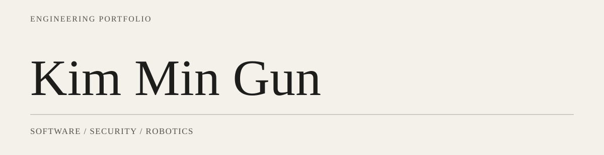
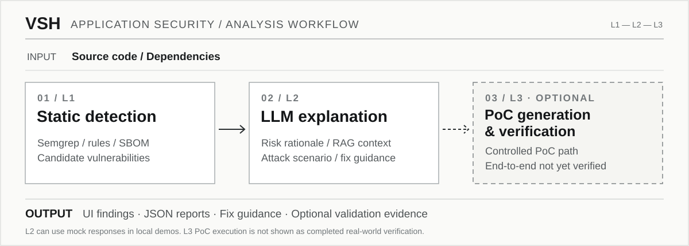
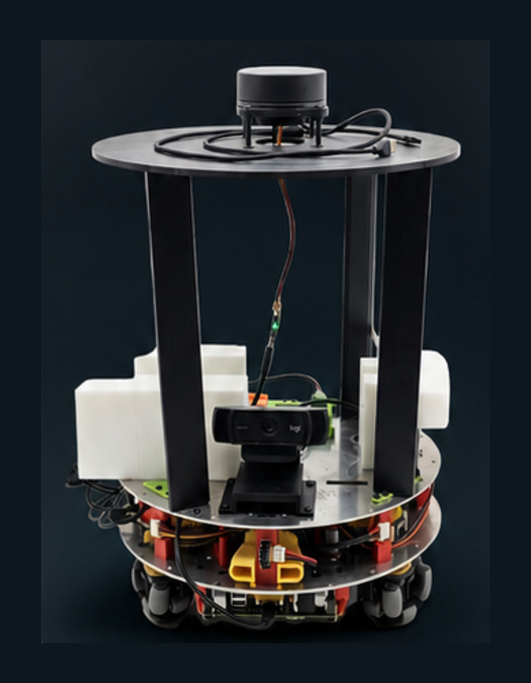

<picture>
  <source media="(max-width: 600px)" srcset="assets/profile-banner-mobile.svg">
  
</picture>

<strong>한국어</strong> &nbsp; | &nbsp; <a href="README.en.md">English</a>

# 김민건

**Software Engineering · Security · Systems · Robotics**

보안 분석 도구를 개발하고, ROS 2 기반 실물 로봇의 설계와 통합을 수행했습니다.  
새로운 도구를 만들었다는 사실보다 **어떤 문제를 검증하려 했고, 실제로 어디까지 재현·확인했는지**를 보여주려 합니다.

기존 상용 보안 제품의 기능을 대체했다고 주장하지 않습니다. 검증 자동화, 결과의 추적 가능성, 시스템 통합과 장애 대응을 직접 구현한 범위로 설명합니다.

소프트웨어공학 전공 · 2027년 2월 졸업 예정

[기술 블로그](https://rasasoe.tistory.com/) · [완료된 프로젝트](#완료된-프로젝트) · [진행 중인 프로젝트](#진행-중인-프로젝트)

---

## 완료된 프로젝트

구현과 시연 또는 로컬 테스트까지 마친 범위를 정리했습니다. *완료*는 **명시한 범위의 구현·검증을 마쳤다**는 뜻이지, 상용 제품 수준의 전체 검증을 뜻하지 않습니다.

**기간 표기 기준:** 프로젝트에서 확인된 개발 기간은 그대로 적고, 착수·종료일을 확인하지 못한 경우 GitHub 작업·실험·테스트의 **확인된 활동 기간**으로 구분했습니다. 저장소 생성일을 개발 시작일로 간주하지 않았습니다.

### 01. [VSH — 애플리케이션 보안 분석](https://github.com/rasasoe/VSH)

**활동·검증 기록:** 2026.02–2026.09 (실제 개발 착수·종료일과 구분)

**검증 목표:** 정적 분석 경고를 사람이 다시 검토하고 조치할 수 있도록, **실제 Semgrep 실행 → 결과 정규화 → 화면·JSON 출력** 흐름이 재현 가능한지 확인하는 AppSec 프로토타입입니다.

- **담당:** 기존 팀 프로젝트의 [upstream fork](https://github.com/vmfmgl0607/VSH)를 기반으로 Semgrep 실행·설정 연동, Windows 도구 wrapper, Finding v1.0 JSON export 및 테스트를 개인적으로 확장했습니다.
- **검증 결과:** 단위 테스트 81개 및 역순 실행 81개 통과, React 프로덕션 빌드 통과 (2026-09-16). 로컬 취약 코드 fixture의 분석 UI도 실행했습니다.
- **미검증:** L2 설명은 mock이며, L3의 실제 취약점 검증·LLM 분석 품질과 실환경 탐지 정확도는 입증하지 않았습니다.

`Python` · `FastAPI` · `Semgrep` · `React` · `Electron`

[실행 화면](https://github.com/rasasoe/VSH#실행-화면) · [개인 기여와 커밋](https://github.com/rasasoe/VSH#my-contributions) · [검증과 한계](https://github.com/rasasoe/VSH#검증과-한계)

### 02. [BuddyBot — ROS 2 실내 이동 로봇](https://github.com/rasasoe/BuddyBot)

**개발 기간:** 2025.03–2026.06  
**3인 팀 프로젝트 · 팀장 / 전체 아키텍처 설계 / 시스템 통합**

**검증 목표:** Linux 기반 인지·계획 계층과 MCU의 모터·안전 제어 계층을 분리해도, 여러 입력을 중재하며 **실물 로봇이 안전하게 주행·정지·추종하는지** 확인했습니다.

- Raspberry Pi 5의 ROS 2 인지·경로 계획과 Raspberry Pi Pico의 모터 제어를 분리하고 UART로 연결했습니다.
- LiDAR 기반 이동, 사용자 추종, 음성 요청을 통합하고 command mux 및 watchdog 안전 제어를 설계했습니다.
- **검증 결과:** 실물 로봇의 체크포인트 이동·장애물 회피·사용자 추종·음성 제어·비상정지 데모를 기록했습니다. 이는 실제 하드웨어 통합 검증이며, 모든 예외 상황에서의 안전성을 인증한 결과는 아닙니다.

`ROS 2` · `Python` · `Raspberry Pi` · `RP2040` · `OpenCV`

[동작 영상](https://github.com/rasasoe/BuddyBot#동작-데모) · [시스템 아키텍처](https://github.com/rasasoe/BuddyBot#전체-아키텍처)

### 그 밖의 구현·검증 프로젝트

| 프로젝트 | 확인된 활동 기간 | 검증하려 한 것과 결과 |
| --- | --- | --- |
| [DotasPlus](https://github.com/rasasoe/DotasPlus) | 2025.12–2026.09 | 외부 문서의 IOC가 보호 자산 및 Incident와 일관되게 연결되는지 확인. 로컬 fixture 테스트 9개 통과 |
| [Python ASM Framework](https://github.com/rasasoe/python-asm-framework) | 2026.02–2026.09 | 승인된 대상만 분석하고 노출·서비스·위험 결과를 일관된 형식으로 출력하는지 확인. 오프라인 단위 테스트 6개 통과 |
| [AMR](https://github.com/rasasoe/AMR) | 2025.10–2026.02 | 엔코더 피드백·P제어·역기구학으로 바퀴별 속도를 제어하는 로직 구현 및 실험 |
| [MRP3MV4](https://github.com/rasasoe/MRP3MV4) | 2025.08–2026.02 | AVR·LM629을 활용한 옴니휠 구동 및 센서·카메라 기반 동작 실험 |

위 표의 날짜는 **개발 착수·종료가 확정된 기간이 아니라 확인된 작업·검증 활동의 범위**입니다. DotasPlus·ASM은 로컬·모의 입력 테스트를 확인한 상태로, 실제 외부 서비스 전체의 종단 간 수집 성공을 주장하지 않습니다.

---

## 진행 중인 프로젝트

### [AEGIS — 자율 보안 AI 플랫폼](https://github.com/rasasoe/AEGIS-Showcase)

**진행 중 · 공개 개발·검증 기록:** 2026.10–현재 (실제 최초 착수일과 구분)  
**개인 프로젝트 · 로컬 LLM과 보안 에이전트의 실행 권한 분리**

**검증 목표:** AI가 판단을 내리더라도 승인되지 않은 대상이나 도구를 실행하지 못하는지, 중단 명령이 **실제 실행 중인 작업까지 종료**하는지, 보고서의 판단이 **확인 가능한 도구 증거와 연결**되는지 검증하려는 프로젝트입니다.

PentAGI와 Ollama를 연동하고, 범위 확인 → 승인 → 격리 실행 → 증거 검토를 위한 통제 계층을 개발하고 있습니다.

- **확인된 결과:** Python Controller, 모델 연결, 승인·범위 검증, 독립 감시기 모의 테스트. 2026-10-26 기록 기준 자동 회귀 테스트 305/305 통과(실제 취약점 발견 성공률이 아닌 로컬 테스트 결과).
- **아직 검증할 것:** 실제 PentAGI 작업 종료 보장, 허가된 실습 환경에서의 자율 분석·HTTP 증거 수집 및 검증 가능한 보고서 생성.
- **공개 범위:** 설계·검증 현황을 공개하며, 개발 소스는 비공개입니다.

`Python` · `Ollama` · `PentAGI` · `Docker` · `QEMU`

[아키텍처·개발 현황](https://github.com/rasasoe/AEGIS-Showcase)

---

### 기술과 기록

**Python · Linux · Docker · FastAPI · AppSec · ROS 2 · 임베디드 시스템**

개발 과정의 문제 해결과 기술 학습은 [Devin's Security Lab](https://rasasoe.tistory.com/)에 기록합니다.
